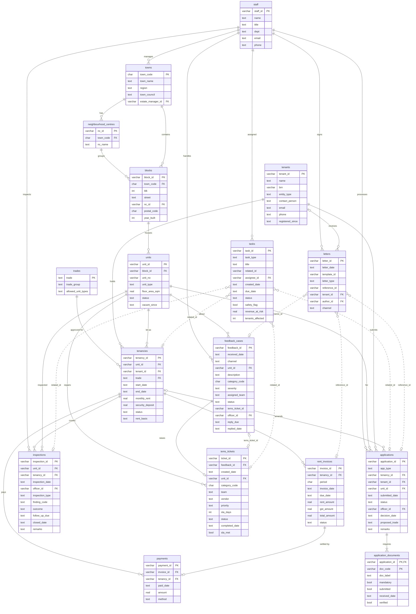

# PLG Records POC database

SQLite database built from the CSV export in [`database/`](database/). All data is fictional.

| | |
|---|---|
| File | `poc-data/plg_records.db` |
| Engine | SQLite 3 |
| Source | `poc-data/database/*.csv` + `schema.sql` |
| Loader | `poc-data/_generator/load_sqlite.py` |
| Data window | Oct 2025 – Sep 2026; unit status is a snapshot as at **2026-09-30** |
| Rebuild | `.venv/bin/python poc-data/_generator/load_sqlite.py --overwrite` |

## Conventions

- **Dates** are ISO-8601 `TEXT` (`YYYY-MM-DD`). Compare as strings and use `julianday()` / `date()` for arithmetic. `schema.sql` declares them `DATE`; the loader rewrites them to `TEXT` because a `DATE` column gets NUMERIC affinity in SQLite and compares wrongly against string literals.
- **Money** is `REAL` in Singapore dollars (`schema.sql` declares `NUMERIC(p,s)`). Round in queries: `ROUND(SUM(total_amount), 2)`.
- **Booleans** are `INTEGER` 1/0, with NULL where the state is unknown.
- **Foreign keys** are declared but SQLite only enforces them per connection: run `PRAGMA foreign_keys = ON;` first. The loaded data passes `PRAGMA foreign_key_check` with no violations.
- **IDs** are human-readable, prefixed strings (`TA-2023-00002`, `INV-2510-000001`, …) and are the primary keys.

## Table summary

| Table | Area | Rows | Description |
|---|---|--:|---|
| [`staff`](#staff) | Reference | 12 | Properties & Land Group (PLG) officers: estate managers, leasing, inspections, finance, legal, customer relations. |
| [`towns`](#towns) | Reference | 6 | The six fictional HDB towns, with region, town council and the responsible estate manager. |
| [`neighbourhood_centres`](#neighbourhood_centres) | Reference | 18 | Neighbourhood centres (NCs): clusters of commercial blocks within a town, three per town. |
| [`blocks`](#blocks) | Reference | 150 | Commercial blocks (HDB blocks with shops), each in a town and an NC. |
| [`trades`](#trades) | Reference | 25 | Approved trade list, grouped, with the unit types each trade may occupy. |
| [`units`](#units) | Property | 1,645 | Lettable commercial units. `status` is a snapshot as at 2026-09-30. |
| [`tenants`](#tenants) | Property | 1,858 | Business entities that rent units (companies or sole proprietorships). |
| [`tenancies`](#tenancies) | Property | 2,397 | Tenancy agreements: one tenant renting one unit for one trade over a term (usually 3 years). |
| [`rent_invoices`](#rent_invoices) | Finance | 17,530 | Monthly rent invoices, Oct 2025 – Sep 2026, with 9% GST. |
| [`payments`](#payments) | Finance | 17,262 | Payments received against invoices (at most one per invoice). |
| [`inspections`](#inspections) | Operations | 2,532 | Unit inspections by property officers / estate managers, with findings and follow-up. |
| [`feedback_cases`](#feedback_cases) | Operations | 1,180 | Public and tenant feedback cases from all channels, with reply SLA. |
| [`iems_tickets`](#iems_tickets) | Operations | 590 | i-EMS maintenance tickets raised from defect-type feedback, routed to a team and vendor, with SLA tracking. |
| [`applications`](#applications) | Operations | 410 | Tenant applications: new tenancy, renewal, assignment, change of trade, alteration & addition. |
| [`application_documents`](#application_documents) | Operations | 2,178 | Checklist of supporting documents per application, with submission/verification state. |
| [`tasks`](#tasks) | Operations | 1,315 | Officer work queue: follow-ups generated from inspections, arrears, renewals, applications and defects. |
| [`letters`](#letters) | Operations | 4,151 | Outgoing correspondence log (arrears reminders, letters of demand, feedback updates, missing-document notices). |

## Schema diagram

Solid lines are declared foreign keys. Dotted lines are logical references (no declared FK; see [Logical references](#logical-references)). A rendered copy is in [`_database_schema.png`](_database_schema.png) for viewers without Mermaid support.



## Logical references

These columns hold IDs from different tables depending on another column, so they have no declared foreign key. Join on them with the matching filter.

| Column | Determined by | Points to |
|---|---|---|
| `feedback_cases.iems_ticket_id` | — | `iems_tickets.ticket_id` (the reverse of `iems_tickets.feedback_id`) |
| `tasks.related_id` | `task_type` | Application Review → `applications`; Arrears Follow-up → `tenancies`; Defect Follow-up → `iems_tickets`; Inspection Follow-up → `inspections`; Renewal → `tenancies` |
| `letters.reference_id` | `letter_type` | Arrears Reminder (1st) → `rent_invoices`; Arrears Reminder (2nd) → `rent_invoices`; Feedback Update → `feedback_cases`; Letter of Demand → `rent_invoices`; Missing Documents Notice → `applications` |

## Category codes

`feedback_cases.category_code` / `iems_tickets.category_code`. Only defect categories (i-EMS = yes) produce i-EMS tickets.

| Code | Category | i-EMS |
|---|---|---|
| `STR` | Structural | yes |
| `SEP` | Water Seepage / Leak | yes |
| `PLB` | Plumbing & Sanitary | yes |
| `ELE` | Electrical | yes |
| `FIR` | Fire Safety | yes |
| `PST` | Pest | yes |
| `HYG` | Hygiene (Tenant) | no |
| `ENC` | Obstruction / Encroachment | no |
| `NOI` | Noise / Nuisance | no |
| `CMN` | Common Area (Town Council) | no |
| `OTH` | General Enquiry / Non-defect | no |

## Planned data-quality issues

The export deliberately contains these issues so the POC can be tested against them. The loader keeps them all except the duplicate payment row, which would break the primary key.

| Issue | Where | Find it |
|---|---|---|
| Duplicate tenant (same BRN) | `tenants` `T-10514` / `T-19807` | `SELECT brn FROM tenants GROUP BY brn HAVING COUNT(*) > 1` |
| Missing floor area | 5 rows in `units` | `WHERE floor_area_sqm IS NULL` |
| Missing tenant email | 71 rows in `tenants` | `WHERE email IS NULL` |
| Outlier rent (S$63,100) | `tenancies` `TA-2022-00400` | `ORDER BY monthly_rent DESC LIMIT 1` |
| Far-future inspection date | `inspections` `INSP-2025-0125` (2099-10-18) | `WHERE inspection_date > '2026-12-31'` |
| Duplicated payment row | `payments.csv` `PAY-00001235` | Skipped at load; reported by the loader |

## Tables

### staff

Properties & Land Group (PLG) officers: estate managers, leasing, inspections, finance, legal, customer relations. **12 rows.**

| Column | Type | Key | Nulls | Description |
|---|---|---|--:|---|
| `staff_id` | VARCHAR(4) | PK | 0 | Staff code `S01`–`S12`. |
| `name` | TEXT NOT NULL |  | 0 | Full name. |
| `title` | TEXT |  | 0 | Job title. |
| `dept` | TEXT |  | 0 | Department. |
| `email` | TEXT |  | 0 | Work email (unique). |
| `phone` | TEXT |  | 0 | Office phone. |

**Indexes**

- primary key: `(automatic)` on (staff_id)
- unique: `(automatic)` on (email)

**Foreign keys**

- Referenced by: `towns.estate_manager_id`, `inspections.officer_id`, `feedback_cases.officer_id`, `applications.officer_id`, `tasks.assignee_id`, `letters.author_id`

**Sample query**

```sql
SELECT s.staff_id, s.name, s.title, COUNT(t.task_id) AS open_tasks
FROM staff s
LEFT JOIN tasks t ON t.assignee_id = s.staff_id AND t.status IN ('Open', 'In Progress', 'Overdue')
GROUP BY s.staff_id
ORDER BY open_tasks DESC;
```

### towns

The six fictional HDB towns, with region, town council and the responsible estate manager. **6 rows.**

| Column | Type | Key | Nulls | Description |
|---|---|---|--:|---|
| `town_code` | CHAR(2) | PK | 0 | 2-letter town code: BV, CD, KR, RH, ST, PI. |
| `town_name` | TEXT NOT NULL |  | 0 | Town name. |
| `region` | TEXT |  | 0 | `East` / `West`. |
| `town_council` | TEXT |  | 0 | Managing town council (covers two towns). |
| `estate_manager_id` | VARCHAR(4) | FK → `staff.staff_id` | 0 | Responsible estate manager. |

**Indexes**

- primary key: `(automatic)` on (town_code)

**Foreign keys**

- `towns.estate_manager_id` → `staff.staff_id`
- Referenced by: `neighbourhood_centres.town_code`, `blocks.town_code`

**Sample query**

```sql
SELECT t.town_name, t.region, s.name AS estate_manager
FROM towns t
JOIN staff s ON s.staff_id = t.estate_manager_id
ORDER BY t.region, t.town_name;
```

### neighbourhood_centres

Neighbourhood centres (NCs): clusters of commercial blocks within a town, three per town. **18 rows.**

| Column | Type | Key | Nulls | Description |
|---|---|---|--:|---|
| `nc_id` | VARCHAR(8) | PK | 0 | `NC-<town>-<n>`, e.g. `NC-BV-1`. |
| `town_code` | CHAR(2) | FK → `towns.town_code` | 0 | Town the NC is in. |
| `nc_name` | TEXT |  | 0 | NC display name. |

**Indexes**

- primary key: `(automatic)` on (nc_id)

**Foreign keys**

- `neighbourhood_centres.town_code` → `towns.town_code`
- Referenced by: `blocks.nc_id`

**Sample query**

```sql
SELECT nc.nc_name, COUNT(DISTINCT b.block_id) AS blocks, COUNT(u.unit_id) AS units
FROM neighbourhood_centres nc
JOIN blocks b ON b.nc_id = nc.nc_id
JOIN units u ON u.block_id = b.block_id
WHERE nc.town_code = 'BV'
GROUP BY nc.nc_id;
```

### blocks

Commercial blocks (HDB blocks with shops), each in a town and an NC. **150 rows.**

| Column | Type | Key | Nulls | Description |
|---|---|---|--:|---|
| `block_id` | VARCHAR(8) | PK | 0 | Town code + block number, e.g. `BV204`. |
| `town_code` | CHAR(2) | FK → `towns.town_code` | 0 | Town. |
| `blk` | INT |  | 0 | Block number. |
| `street` | TEXT |  | 0 | Street name. |
| `nc_id` | VARCHAR(8) | FK → `neighbourhood_centres.nc_id` | 0 | Neighbourhood centre. |
| `postal_code` | CHAR(6) |  | 0 | 6-digit postal code. |
| `year_built` | INT |  | 0 | Year of completion. |

**Indexes**

- primary key: `(automatic)` on (block_id)
- index: `ix_blocks_town` on (town_code)

**Foreign keys**

- `blocks.nc_id` → `neighbourhood_centres.nc_id`
- `blocks.town_code` → `towns.town_code`
- Referenced by: `units.block_id`

**Sample query**

```sql
SELECT b.blk, b.street, b.postal_code, b.year_built
FROM blocks b
WHERE b.town_code = 'CD' AND b.year_built < 1990
ORDER BY b.year_built;
```

### trades

Approved trade list, grouped, with the unit types each trade may occupy. **25 rows.**

| Column | Type | Key | Nulls | Description |
|---|---|---|--:|---|
| `trade` | TEXT | PK | 0 | Trade name, e.g. `Minimart`. |
| `trade_group` | TEXT |  | 0 | Grouping, e.g. `Healthcare`, `Food & Beverage`. |
| `allowed_unit_types` | TEXT |  | 0 | Pipe-separated list of permitted `units.unit_type` values. |

**Indexes**

- primary key: `(automatic)` on (trade)

**Foreign keys**

- Referenced by: `tenancies.trade`

**Sample query**

```sql
SELECT tr.trade_group, tr.trade, COUNT(te.tenancy_id) AS active_tenancies
FROM trades tr
LEFT JOIN tenancies te ON te.trade = tr.trade AND te.status = 'Active'
GROUP BY tr.trade
ORDER BY tr.trade_group, active_tenancies DESC;
```

### units

Lettable commercial units. `status` is a snapshot as at 2026-09-30. **1,645 rows.**

| Column | Type | Key | Nulls | Description |
|---|---|---|--:|---|
| `unit_id` | VARCHAR(16) | PK | 0 | `U-<block_id>-<floor>-<unit>`, e.g. `U-BV204-01-03`. |
| `block_id` | VARCHAR(8) | FK → `blocks.block_id` | 0 | Block. |
| `unit_no` | VARCHAR(8) |  | 0 | Unit number, e.g. `#01-03`. |
| `unit_type` | TEXT |  | 0 | `Shop`, `Office`, `Kiosk`, `Shop with Living Quarters`, `Eating House`. |
| `floor_area_sqm` | REAL |  | 5 | Floor area in m². **5 NULLs (planned DQ issue).** |
| `status` | TEXT |  | 0 | `Tenanted`, `Vacant`, `Under Tender`, `Not Lettable` (CHECK constraint). |
| `vacant_since` | TEXT (date) |  | 1,587 | Date the unit became vacant; NULL when tenanted. |

**Indexes**

- primary key: `(automatic)` on (unit_id)
- index: `ix_units_block` on (block_id)
- index: `ix_units_status` on (status)

**Foreign keys**

- `units.block_id` → `blocks.block_id`
- Referenced by: `tenancies.unit_id`, `inspections.unit_id`, `feedback_cases.unit_id`, `iems_tickets.unit_id`, `applications.unit_id`

**Sample query**

```sql
SELECT u.unit_id, u.unit_type, u.floor_area_sqm, u.vacant_since,
       CAST(julianday('2026-09-30') - julianday(u.vacant_since) AS INT) AS days_vacant
FROM units u
JOIN blocks b ON b.block_id = u.block_id
WHERE u.status = 'Vacant' AND b.town_code = 'PI'
ORDER BY days_vacant DESC;
```

### tenants

Business entities that rent units (companies or sole proprietorships). **1,858 rows.**

| Column | Type | Key | Nulls | Description |
|---|---|---|--:|---|
| `tenant_id` | VARCHAR(8) | PK | 0 | `T-nnnnn`. |
| `name` | TEXT NOT NULL |  | 0 | Registered business name. |
| `brn` | VARCHAR(12) |  | 0 | Business registration number (UEN). Not unique: **`T-10514`/`T-19807` share one (planned duplicate).** |
| `entity_type` | TEXT |  | 0 | `Company` / `Sole Proprietorship`. |
| `contact_person` | TEXT |  | 0 | Main contact. |
| `email` | TEXT |  | 71 | Contact email. **71 NULLs (planned DQ issue).** |
| `phone` | TEXT |  | 0 | Contact phone. |
| `registered_since` | TEXT (date) |  | 0 | Business registration date. |

**Indexes**

- primary key: `(automatic)` on (tenant_id)
- index: `ix_tenants_brn` on (brn)

**Foreign keys**

- Referenced by: `tenancies.tenant_id`, `applications.tenant_id`, `letters.tenant_id`

**Sample query**

```sql
-- Possible duplicate tenant records (same business registration number)
SELECT brn, GROUP_CONCAT(tenant_id || ' ' || name, ' | ') AS records
FROM tenants
GROUP BY brn
HAVING COUNT(*) > 1;
```

### tenancies

Tenancy agreements: one tenant renting one unit for one trade over a term (usually 3 years). **2,397 rows.**

| Column | Type | Key | Nulls | Description |
|---|---|---|--:|---|
| `tenancy_id` | VARCHAR(16) | PK | 0 | `TA-<start year>-nnnnn`. |
| `unit_id` | VARCHAR(16) | FK → `units.unit_id` | 0 | Unit let. |
| `tenant_id` | VARCHAR(8) | FK → `tenants.tenant_id` | 0 | Tenant. |
| `trade` | TEXT | FK → `trades.trade` | 0 | Approved trade for the tenancy. |
| `start_date` | TEXT (date) |  | 0 | Term start. |
| `end_date` | TEXT (date) |  | 0 | Term end. |
| `monthly_rent` | REAL |  | 0 | Monthly rent (S$, before GST). **Outlier S$63,100 on `TA-2022-00400`.** |
| `security_deposit` | REAL |  | 0 | Deposit held (S$, normally 3 × rent). |
| `status` | TEXT |  | 0 | `Active`, `Renewed`, `Expired`, `Terminated`, `Pending Commencement`. |
| `rent_basis` | TEXT |  | 0 | `Market (tender)` / `Market (renewal valuation)`. |

**Indexes**

- primary key: `(automatic)` on (tenancy_id)
- index: `ix_tenancies_end` on (end_date)
- index: `ix_tenancies_tenant` on (tenant_id)
- index: `ix_tenancies_unit` on (unit_id)

**Foreign keys**

- `tenancies.trade` → `trades.trade`
- `tenancies.tenant_id` → `tenants.tenant_id`
- `tenancies.unit_id` → `units.unit_id`
- Referenced by: `rent_invoices.tenancy_id`, `payments.tenancy_id`, `inspections.tenancy_id`, `applications.tenancy_id`

**Sample query**

```sql
-- Active tenancies expiring in the next 6 months
SELECT te.tenancy_id, te.unit_id, tn.name, te.trade, te.end_date, te.monthly_rent
FROM tenancies te
JOIN tenants tn ON tn.tenant_id = te.tenant_id
WHERE te.status = 'Active' AND te.end_date BETWEEN '2026-10-01' AND '2027-03-31'
ORDER BY te.end_date;
```

### rent_invoices

Monthly rent invoices, Oct 2025 – Sep 2026, with 9% GST. **17,530 rows.**

| Column | Type | Key | Nulls | Description |
|---|---|---|--:|---|
| `invoice_id` | VARCHAR(16) | PK | 0 | `INV-<yymm>-nnnnnn`. |
| `tenancy_id` | VARCHAR(16) | FK → `tenancies.tenancy_id` | 0 | Tenancy billed. |
| `period` | CHAR(7) |  | 0 | Billing month `YYYY-MM`. |
| `invoice_date` | TEXT (date) |  | 0 | Issue date. |
| `due_date` | TEXT (date) |  | 0 | Due date (1st of the period month). |
| `rent_amount` | REAL |  | 0 | Rent (S$). |
| `gst_amount` | REAL |  | 0 | GST at 9% (S$). |
| `total_amount` | REAL |  | 0 | Rent + GST (S$). |
| `status` | TEXT |  | 0 | `Paid` / `Unpaid`. |

**Indexes**

- primary key: `(automatic)` on (invoice_id)
- index: `ix_invoices_status` on (status, due_date)
- index: `ix_invoices_tenancy` on (tenancy_id, due_date)

**Foreign keys**

- `rent_invoices.tenancy_id` → `tenancies.tenancy_id`
- Referenced by: `payments.invoice_id`

**Sample query**

```sql
-- Arrears by tenancy: unpaid invoices and amount outstanding
SELECT ri.tenancy_id, tn.name, COUNT(*) AS unpaid_invoices,
       ROUND(SUM(ri.total_amount), 2) AS outstanding, MIN(ri.due_date) AS oldest_due
FROM rent_invoices ri
JOIN tenancies te ON te.tenancy_id = ri.tenancy_id
JOIN tenants tn ON tn.tenant_id = te.tenant_id
WHERE ri.status = 'Unpaid'
GROUP BY ri.tenancy_id
ORDER BY outstanding DESC
LIMIT 10;
```

### payments

Payments received against invoices (at most one per invoice). **17,262 rows.**

| Column | Type | Key | Nulls | Description |
|---|---|---|--:|---|
| `payment_id` | VARCHAR(12) | PK | 0 | `PAY-nnnnnnnn`. Source CSV repeats `PAY-00001235` (planned DQ issue; skipped at load). |
| `invoice_id` | VARCHAR(16) | FK → `rent_invoices.invoice_id` | 0 | Invoice settled. |
| `tenancy_id` | VARCHAR(16) | FK → `tenancies.tenancy_id` | 0 | Tenancy (denormalised from the invoice). |
| `paid_date` | TEXT (date) |  | 0 | Date received. |
| `amount` | REAL |  | 0 | Amount paid (S$). |
| `method` | TEXT |  | 0 | `GIRO`, `PayNow`, `Cheque`, `Bank Transfer`. |

**Indexes**

- primary key: `(automatic)` on (payment_id)
- index: `ix_payments_invoice` on (invoice_id)
- index: `ix_payments_tenancy` on (tenancy_id, paid_date)

**Foreign keys**

- `payments.tenancy_id` → `tenancies.tenancy_id`
- `payments.invoice_id` → `rent_invoices.invoice_id`

**Sample query**

```sql
-- Payment method mix and average days paid after due date
SELECT p.method, COUNT(*) AS payments,
       ROUND(AVG(julianday(p.paid_date) - julianday(ri.due_date)), 1) AS avg_days_after_due
FROM payments p
JOIN rent_invoices ri ON ri.invoice_id = p.invoice_id
GROUP BY p.method
ORDER BY payments DESC;
```

### inspections

Unit inspections by property officers / estate managers, with findings and follow-up. **2,532 rows.**

| Column | Type | Key | Nulls | Description |
|---|---|---|--:|---|
| `inspection_id` | VARCHAR(12) | PK | 0 | `INSP-<year>-nnnn`. |
| `unit_id` | VARCHAR(16) | FK → `units.unit_id` | 0 | Unit inspected. |
| `tenancy_id` | VARCHAR(16) | FK → `tenancies.tenancy_id` | 0 | Tenancy in force at the time. |
| `inspection_date` | TEXT (date) |  | 0 | Inspection date. **`INSP-2025-0125` is dated 2099-10-18 (planned DQ issue).** |
| `officer_id` | VARCHAR(4) | FK → `staff.staff_id` | 0 | Inspecting officer. |
| `inspection_type` | TEXT |  | 0 | `Routine`, `Complaint-driven`, `Follow-up`. |
| `finding_code` | TEXT |  | 0 | `NONE`, `DISPLAY_ENCROACH`, `HYGIENE`, `UNAPPROVED_AA`, `UNAUTH_TRADE`, `FIRE_SAFETY`, `STRUCTURAL_DEFECT`, `UNAUTH_SUBLET`. |
| `outcome` | TEXT |  | 0 | `Compliant`, `Minor Breach`, `Major Breach`. |
| `follow_up_due` | TEXT (date) |  | 1,813 | Rectification deadline (breaches only). |
| `closed_date` | TEXT (date) |  | 1,988 | Date the breach was closed; NULL = still open. |
| `remarks` | TEXT |  | 0 | Officer's free-text notes. |

**Indexes**

- primary key: `(automatic)` on (inspection_id)
- index: `ix_inspections_officer` on (officer_id, inspection_date)
- index: `ix_inspections_tenancy` on (tenancy_id)
- index: `ix_inspections_unit` on (unit_id, inspection_date)

**Foreign keys**

- `inspections.officer_id` → `staff.staff_id`
- `inspections.tenancy_id` → `tenancies.tenancy_id`
- `inspections.unit_id` → `units.unit_id`

**Sample query**

```sql
-- Open breaches: follow-up not yet closed
SELECT i.inspection_id, i.unit_id, i.finding_code, i.outcome, i.follow_up_due, s.name AS officer
FROM inspections i
JOIN staff s ON s.staff_id = i.officer_id
WHERE i.outcome <> 'Compliant' AND i.closed_date IS NULL
ORDER BY i.follow_up_due;
```

### feedback_cases

Public and tenant feedback cases from all channels, with reply SLA. **1,180 rows.**

| Column | Type | Key | Nulls | Description |
|---|---|---|--:|---|
| `feedback_id` | VARCHAR(14) | PK | 0 | `FB-<year>-nnnnn`. |
| `received_date` | TEXT (date) |  | 0 | Date received. |
| `channel` | TEXT |  | 0 | `CityFix App`, `Email`, `Walk-in`, `Hotline`, `MP Letter`. |
| `unit_id` | VARCHAR(16) | FK → `units.unit_id` | 0 | Unit the feedback concerns. |
| `description` | TEXT |  | 0 | Free-text complaint as received (mixed case, typos). |
| `category_code` | CHAR(3) |  | 0 | See category codes below. |
| `severity` | TEXT |  | 0 | `Low`, `Medium`, `High`, `Critical`. |
| `assigned_team` | TEXT |  | 0 | Team handling the case. |
| `status` | TEXT |  | 0 | `Open`, `In Progress`, `Closed`. |
| `iems_ticket_id` | VARCHAR(16) |  | 590 | i-EMS ticket raised, if any. Logical link to `iems_tickets.ticket_id` (no declared FK). |
| `officer_id` | VARCHAR(4) | FK → `staff.staff_id` | 0 | Case officer. |
| `reply_due` | TEXT (date) |  | 0 | Reply SLA date. |
| `replied_date` | TEXT (date) |  | 30 | Date replied; NULL = not yet replied. |

**Indexes**

- primary key: `(automatic)` on (feedback_id)
- index: `ix_feedback_status` on (status, reply_due)
- index: `ix_feedback_ticket` on (iems_ticket_id)
- index: `ix_feedback_unit` on (unit_id, received_date)

**Foreign keys**

- `feedback_cases.officer_id` → `staff.staff_id`
- `feedback_cases.unit_id` → `units.unit_id`
- Referenced by: `iems_tickets.feedback_id`

**Sample query**

```sql
-- Cases still awaiting a reply, oldest reply-due first
SELECT f.feedback_id, f.received_date, f.channel, f.category_code, f.severity, f.reply_due
FROM feedback_cases f
WHERE f.replied_date IS NULL
ORDER BY f.reply_due;
```

### iems_tickets

i-EMS maintenance tickets raised from defect-type feedback, routed to a team and vendor, with SLA tracking. **590 rows.**

| Column | Type | Key | Nulls | Description |
|---|---|---|--:|---|
| `ticket_id` | VARCHAR(16) | PK | 0 | `IEMS-<yymm>-nnnn`. |
| `feedback_id` | VARCHAR(14) | FK → `feedback_cases.feedback_id` | 0 | Originating feedback case. |
| `created_date` | TEXT (date) |  | 0 | Ticket creation date. |
| `unit_id` | VARCHAR(16) | FK → `units.unit_id` | 0 | Unit. |
| `category_code` | CHAR(3) |  | 0 | Defect category (`STR`, `SEP`, `PLB`, `ELE`, `FIR`, `PST`). |
| `team` | TEXT |  | 0 | Maintenance team. |
| `vendor` | TEXT |  | 28 | Term contractor; NULL for some Estate Compliance tickets. |
| `priority` | TEXT |  | 0 | `Low`, `Medium`, `High`, `Critical`. |
| `sla_days` | INT |  | 0 | SLA in days (1, 3, 7, 14). |
| `status` | TEXT |  | 0 | `Assigned`, `In Progress`, `Closed`, `Rejected - Misrouted`. |
| `completed_date` | TEXT (date) |  | 30 | Completion date; NULL while open. |
| `sla_met` | BOOLEAN |  | 30 | 1 = met, 0 = breached, NULL = not completed. |

**Indexes**

- primary key: `(automatic)` on (ticket_id)
- index: `ix_tickets_feedback` on (feedback_id)
- index: `ix_tickets_unit` on (unit_id, created_date)

**Foreign keys**

- `iems_tickets.unit_id` → `units.unit_id`
- `iems_tickets.feedback_id` → `feedback_cases.feedback_id`

**Sample query**

```sql
-- SLA performance by maintenance team
SELECT team, COUNT(*) AS tickets, SUM(sla_met) AS met,
       ROUND(100.0 * SUM(sla_met) / COUNT(sla_met), 1) AS pct_met
FROM iems_tickets
WHERE status = 'Closed'
GROUP BY team
ORDER BY pct_met;
```

### applications

Tenant applications: new tenancy, renewal, assignment, change of trade, alteration & addition. **410 rows.**

| Column | Type | Key | Nulls | Description |
|---|---|---|--:|---|
| `application_id` | VARCHAR(12) | PK | 0 | `APP-<year>-nnnn`. |
| `app_type` | TEXT |  | 0 | `NEW_TENANCY`, `RENEWAL`, `ASSIGNMENT`, `CHANGE_OF_TRADE`, `ALTERATION`. |
| `tenancy_id` | VARCHAR(16) | FK → `tenancies.tenancy_id` | 94 | Existing tenancy; NULL for all `NEW_TENANCY` applications. |
| `tenant_id` | VARCHAR(8) | FK → `tenants.tenant_id` | 0 | Applicant. |
| `unit_id` | VARCHAR(16) | FK → `units.unit_id` | 0 | Unit concerned. |
| `submitted_date` | TEXT (date) |  | 0 | Submission date. |
| `status` | TEXT |  | 0 | `Approved`, `Rejected`, `Pending Documents`, `Under Review`, `Withdrawn`. |
| `officer_id` | VARCHAR(4) | FK → `staff.staff_id` | 0 | Processing officer. |
| `decision_date` | TEXT (date) |  | 68 | Decision date; NULL while undecided or withdrawn. |
| `proposed_trade` | TEXT |  | 355 | New trade (`CHANGE_OF_TRADE` only). |
| `remarks` | TEXT |  | 407 | Officer notes (rare). |

**Indexes**

- primary key: `(automatic)` on (application_id)
- index: `ix_apps_tenancy` on (tenancy_id)
- index: `ix_apps_tenant` on (tenant_id)
- index: `ix_apps_unit` on (unit_id)

**Foreign keys**

- `applications.officer_id` → `staff.staff_id`
- `applications.unit_id` → `units.unit_id`
- `applications.tenant_id` → `tenants.tenant_id`
- `applications.tenancy_id` → `tenancies.tenancy_id`
- Referenced by: `application_documents.application_id`

**Sample query**

```sql
-- Application pipeline by type and status
SELECT app_type, status, COUNT(*) AS applications,
       ROUND(AVG(julianday(decision_date) - julianday(submitted_date)), 1) AS avg_days_to_decision
FROM applications
GROUP BY app_type, status
ORDER BY app_type, applications DESC;
```

### application_documents

Checklist of supporting documents per application, with submission/verification state. **2,178 rows.**

| Column | Type | Key | Nulls | Description |
|---|---|---|--:|---|
| `application_id` | VARCHAR(12) | PK, FK → `applications.application_id` | 0 | Application. |
| `doc_code` | VARCHAR(8) | PK | 0 | Checklist item code, e.g. `LOA`, `BIZ`, `NRIC`, `INS`, `GIRO`. |
| `doc_label` | TEXT |  | 0 | Checklist item description. |
| `mandatory` | BOOLEAN |  | 0 | 1 = mandatory for this application type. |
| `submitted` | BOOLEAN |  | 0 | 1 = received. |
| `received_date` | TEXT (date) |  | 252 | Date received; NULL if not submitted. |
| `verified` | BOOLEAN |  | 2,093 | 1 = verified, 0 = failed verification, NULL = not yet checked. |

**Indexes**

- primary key: `(automatic)` on (application_id, doc_code)

**Foreign keys**

- `application_documents.application_id` → `applications.application_id`

**Sample query**

```sql
-- In-flight applications missing mandatory documents
SELECT a.application_id, a.app_type, a.status, GROUP_CONCAT(d.doc_code) AS missing_docs
FROM applications a
JOIN application_documents d ON d.application_id = a.application_id
WHERE d.mandatory = 1 AND d.submitted = 0
  AND a.status IN ('Pending Documents', 'Under Review')
GROUP BY a.application_id;
```

### tasks

Officer work queue: follow-ups generated from inspections, arrears, renewals, applications and defects. **1,315 rows.**

| Column | Type | Key | Nulls | Description |
|---|---|---|--:|---|
| `task_id` | VARCHAR(12) | PK | 0 | `TSK-<year>-nnnn`. |
| `task_type` | TEXT |  | 0 | `Inspection Follow-up`, `Renewal`, `Arrears Follow-up`, `Application Review`, `Defect Follow-up`. |
| `title` | TEXT |  | 0 | Short description. |
| `related_id` | VARCHAR(16) |  | 0 | ID of the source record; table depends on `task_type` (see Logical references). |
| `assignee_id` | VARCHAR(4) | FK → `staff.staff_id` | 0 | Officer assigned. |
| `created_date` | TEXT (date) |  | 0 | Created. |
| `due_date` | TEXT (date) |  | 0 | Due. |
| `status` | TEXT |  | 0 | `Open`, `In Progress`, `Overdue`, `Done`. |
| `safety_flag` | BOOLEAN |  | 0 | 1 = safety-related (fire, structural). |
| `revenue_at_risk` | REAL |  | 0 | Rent at risk (S$), for prioritisation. |
| `tenants_affected` | INT |  | 0 | Number of tenants affected. |

**Indexes**

- primary key: `(automatic)` on (task_id)
- index: `ix_tasks_assignee` on (assignee_id, status, due_date)
- index: `ix_tasks_related` on (related_id)

**Foreign keys**

- `tasks.assignee_id` → `staff.staff_id`

**Sample query**

```sql
-- Overdue safety-flagged tasks, highest revenue at risk first
SELECT t.task_id, t.task_type, t.title, s.name AS assignee, t.due_date, t.revenue_at_risk
FROM tasks t
JOIN staff s ON s.staff_id = t.assignee_id
WHERE t.status = 'Overdue'
ORDER BY t.safety_flag DESC, t.revenue_at_risk DESC
LIMIT 20;
```

### letters

Outgoing correspondence log (arrears reminders, letters of demand, feedback updates, missing-document notices). **4,151 rows.**

| Column | Type | Key | Nulls | Description |
|---|---|---|--:|---|
| `letter_id` | VARCHAR(14) | PK | 0 | `LTR-<year>-nnnnn`. |
| `letter_date` | TEXT (date) |  | 0 | Date sent. |
| `template_id` | VARCHAR(12) |  | 0 | `TPL-REM-01`, `TPL-LOD-01`, `TPL-FBK-03`, `TPL-DOC-02`. |
| `letter_type` | TEXT |  | 0 | `Arrears Reminder (1st)`, `Arrears Reminder (2nd)`, `Letter of Demand`, `Feedback Update`, `Missing Documents Notice`. |
| `reference_id` | VARCHAR(16) |  | 0 | ID of the record the letter is about; table depends on `letter_type` (see Logical references). |
| `tenant_id` | VARCHAR(8) | FK → `tenants.tenant_id` | 1,148 | Addressee tenant; NULL for feedback updates (sent to the public). |
| `author_id` | VARCHAR(4) | FK → `staff.staff_id` | 0 | Signing officer. |
| `channel` | TEXT |  | 0 | `Email`, `Post`, `Email + Post`. |

**Indexes**

- primary key: `(automatic)` on (letter_id)
- index: `ix_letters_reference` on (reference_id)
- index: `ix_letters_tenant` on (tenant_id, letter_date)

**Foreign keys**

- `letters.author_id` → `staff.staff_id`
- `letters.tenant_id` → `tenants.tenant_id`

**Sample query**

```sql
-- Escalation history for one tenant: reminders and letters of demand, with the invoice they refer to
SELECT l.letter_date, l.letter_type, l.reference_id AS invoice_id, ri.period, ri.total_amount, ri.status
FROM letters l
JOIN rent_invoices ri ON ri.invoice_id = l.reference_id
WHERE l.tenant_id = (SELECT tenant_id FROM letters WHERE letter_type = 'Letter of Demand' LIMIT 1)
ORDER BY l.letter_date;
```
